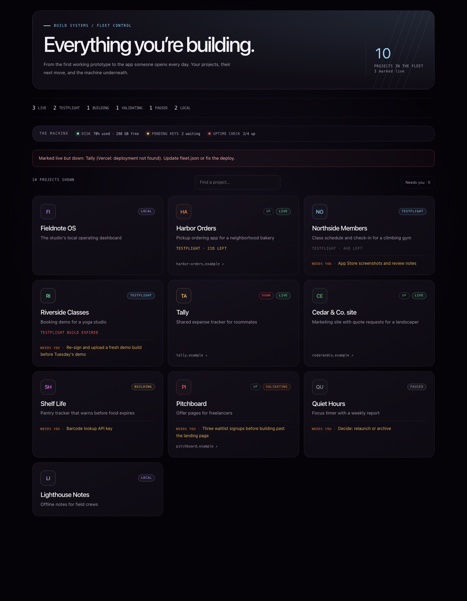
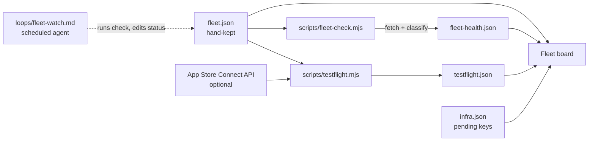

# App Fleet Tracker

A board for builders who run many apps at once: each iOS or web project's release state (local, building, validating, TestFlight, live, paused), whether its URL is really up, how many days its TestFlight build has left, and what it needs from you next.



It started as the FLEET tab in the Business section of Omega, Ian's local operating dashboard, where it tracks his own apps and client builds. It is published here as a standalone Next.js app with a fictional portfolio.

## Why

Once you have more than a handful of apps, the failures are quiet: a Vercel deployment disappears and the page still returns a 200 error shell, a TestFlight build hits its 90-day limit and a tester opens a dead app, and a project marked "live" in your notes has been down for a week. This board is one honest page over a JSON file you edit by hand, plus two scripts that check the things you forget.

## Features

- **Fleet board**: every project as a card with status, platform, URL and a "needs you" line; counts per status, search, and a "needs you" filter.
- **Uptime check that reads the page**: `npm run check` fetches every URL and marks it down for HTTP errors, timeouts, DNS failures, and host error pages that return 200 (deployment not found or paused, app error boundary, empty body, missing title). Exits 1 when something marked `live` is down, so cron can alert you.
- **Status drift banner**: the board flags any project recorded as live whose last check failed.
- **TestFlight expiry**: days left on each build's 90-day window, amber inside 21 days, red when expired.
- **App Store Connect lookup (optional)**: with an API key in env vars, `npm run testflight` signs an ES256 JWT and pulls each app's newest build date instead of relying on hand-kept dates.
- **Machine strip**: disk usage of the host, pending keys or credentials you are waiting on, and the last uptime result.
- **Agent prompts**: `loops/fleet-watch.md` (twice-daily check that keeps statuses honest) and `loops/ship-gate.md` (prove an app builds, runs and handles its states before it moves to TestFlight or live).

## How it works



People edit `fleet.json`; scripts write `fleet-health.json` and `testflight.json`. The board reads all of them on each request. Classification, drift, expiry and validation are pure functions in `lib/fleet.mjs`; the App Store Connect client is `lib/asc.mjs`. `lib/store.mjs` reads `data/<file>` and falls back to `data/example/<file>`.

## Tech stack

Next.js 15 (App Router, server components), React 19, TypeScript, Tailwind CSS 4 plus a CSS module, Node's built-in `fetch`, `crypto` and test runner. No database and no runtime dependencies beyond Next and React.

## Getting started

```bash
git clone https://github.com/ianroyes-sys/app-fleet-tracker.git
cd app-fleet-tracker
npm install
npm test             # 8 tests, including JWT signing against a generated key
npm run dev          # http://localhost:3000, showing data/example
npm run check        # uptime check; writes data/fleet-health.json
npm run testflight   # TestFlight expiry; writes data/testflight.json
```

The sample URLs use the reserved `.example` domain, so `npm run check` on the sample data reports them all as unreachable; that is expected. The sample `fleet-health.json` shows what a real run looks like. The sample `infra.json` pins the clock to 2026-01-20 (`_demoNow`) so the expiry badges read as intended; remove it in your own file or set `DEMO_NOW`.

To track your own apps, put `fleet.json` (and optionally `infra.json`) in `data/` (git-ignored) or point `FLEET_DATA_DIR` elsewhere. For real build dates, create an App Store Connect API key with the App Manager role and set `ASC_KEY_ID`, `ASC_ISSUER_ID` and `ASC_KEY_PATH` in `.env.local` (see `.env.example`). Keep the `.p8` file outside the repo.

## Data format

```jsonc
// fleet.json; status: live | testflight | building | validating | paused | local
[ { "name": "Harbor Orders", "tagline": "Pickup ordering app for a neighborhood bakery", "status": "live",
    "platform": "ios", "url": "https://harbor-orders.example", "testflight": "2025-11-12",
    "ascName": "Harbor Orders", "needs": "…", "color": "#ff8a3d" } ]
// infra.json
{ "pending": [ { "what": "Barcode lookup API key for Shelf Life", "since": "2026-01-10" } ] }
```

`testflight` is the last upload date; `ascName` is the app's name in App Store Connect when it differs from `name`. `npm run check` validates `fleet.json` first and exits 2 with a list of problems.

## Project structure

```
app/
  page.tsx               Fleet board (server component)
  api/fleet/route.ts     JSON: items, health, drift, TestFlight rows, machine checks
components/
  FleetBoard.tsx         Cards, filters and search (client component)
lib/
  fleet.mjs              Statuses, validation, page classification, drift, expiry (pure)
  asc.mjs                App Store Connect JWT and latest-build lookup
  store.mjs              JSON reads with example fallback, clock, disk check
  fleet.test.mjs         node:test suite
scripts/
  fleet-check.mjs        Uptime check, exit 1 on live-but-down
  testflight.mjs         Expiry watcher, ASC or fleet.json dates, exit 1 when a build needs upload
loops/                   Agent prompts: fleet-watch, ship-gate
data/example/            Fictional portfolio
docs/fleet.png           Screenshot from the sample data
```

## Status

Runs locally and builds with `npm run build`; the logic, page classifier and JWT signing are covered by tests. The screenshot is from `npm run start` on the sample data (the disk reading in it is the machine it ran on). In Omega this tab tracks Ian's real apps and the fleet-watch loop runs on a schedule; the loop runner itself is not in this repo, so the prompts in `loops/` are meant for whatever scheduled agent you use. Every app in the sample data is fictional.

Built by [Ian Royes](https://github.com/ianroyes-sys)
